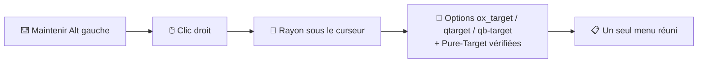

<div align="center">

[](README.md) [](README.fr.md)


<br>

**Un menu clic droit standalone pour FiveM, qui remplace directement `ox_target`, `qtarget` et `qb-target`.**<br>
Maintiens <kbd>Alt gauche</kbd>, fais un clic droit sur n'importe quoi dans le monde, et choisis une action.

<br>

[](https://fivem.net)
[](https://www.lua.org)
[](#%EF%B8%8F-configuration)
[](LICENSE)
[](https://github.com/stefanlesuisse/pure-target/releases)
[](https://www.youtube.com/@ma3iich)
[](https://discord.gg/73w9ZanWyv)

**[⬇️ Télécharger](https://github.com/stefanlesuisse/pure-target/releases/latest)** &nbsp;·&nbsp;
**[📦 Installation](#-installation)** &nbsp;·&nbsp;
**[⚙️ Configuration](#%EF%B8%8F-configuration)** &nbsp;·&nbsp;
**[📚 Exports](exports.md)** &nbsp;·&nbsp;
**[💬 Aide (Discord)](https://discord.gg/73w9ZanWyv)**

<sub>Fork d'<a href="https://www.youtube.com/watch?v=peS7m275vEY">Off-Target</a> par OffSey · Créé par <a href="https://github.com/stefanlesuisse">stefanlesuisse</a></sub>

</div>

---

## 🎬 Aperçu

<table>
  <tr>
    <th width="33%">🧍 Sur soi</th>
    <th width="33%">🚗 Sur un véhicule</th>
    <th width="33%">👥 Sur un autre joueur</th>
  </tr>
  <tr>
    <td><video src="https://github.com/user-attachments/assets/febb8a09-3055-4492-b8f2-6df00d5b6ddb" width="100%" controls muted></video></td>
    <td><video src="https://github.com/user-attachments/assets/3a4e1e92-412c-4db3-99e9-873c5bdfd65a" width="100%" controls muted></video></td>
    <td><video src="https://github.com/user-attachments/assets/72a18f0b-32a2-4ec7-91aa-7314a5673ad0" width="100%" controls muted></video></td>
  </tr>
</table>

> [!NOTE]
> Les options visibles dans ces clips viennent des scripts de notre serveur, construits avec l'API de Pure-Target.
> Sur ton serveur, le menu affiche les options de **tes** propres scripts.

---

## ✨ Fonctionnalités

<table>
  <tr>
    <td width="50%">🖱️ <b>Menu clic droit</b><br><sub>À la place du classique « œil » : on maintient la touche, un curseur apparaît, on fait un clic droit sur ce qu'on veut.</sub></td>
    <td width="50%">🔌 <b>Remplace directement</b><br><sub><code>ox_target</code>, <code>qtarget</code> et <code>qb-target</code> : tes scripts actuels continuent de marcher, rien à modifier.</sub></td>
  </tr>
  <tr>
    <td>🧩 <b>Standalone</b><br><sub>Aucun framework, pas d'ox_lib, pas de base de données. QBox / QBCore / ESX sont détectés automatiquement pour les filtres de métier et d'objets.</sub></td>
    <td>🎯 <b>Ciblage précis</b><br><sub>Sélectionne exactement l'objet sous le curseur, même les props de la map sans collision propre (distributeurs muraux, mobilier encastré...).</sub></td>
  </tr>
  <tr>
    <td>📌 <b>Le menu reste ouvert</b><br><sub>Tant que la touche est maintenue : on ouvre plusieurs portes à la suite, les textes se mettent à jour en direct.</sub></td>
    <td>🚗 <b>Options véhicule intégrées</b><br><sub>Ouvrir / fermer la porte, le capot ou le coffre visé, baisser les fenêtres depuis l'intérieur (synchronisé par le serveur).</sub></td>
  </tr>
  <tr>
    <td>🎨 <b>Interface soignée</b><br><sub>Thème sombre au trait fin, ne sort jamais de l'écran, longues listes en colonnes, sous-menus, cases à cocher, bulles d'aide.</sub></td>
    <td>🌍 <b>13 langues</b><br><sub>EN, FR, DE, ES, IT, PT, NL, PL, TR, RU, ZH, JA, KO — facile d'en ajouter.</sub></td>
  </tr>
  <tr>
    <td>⚡ <b>Léger</b><br><sub>Aucune boucle ne tourne quand le menu est fermé ; le ciblage n'est calculé qu'au clic droit.</sub></td>
    <td>🛠️ <b>Sa propre API</b><br><sub>Crée tes menus : options, cases à cocher, sous-menus, séparateurs, lignes d'info.</sub></td>
  </tr>
</table>

## 🧭 Comment ça marche



---

## 📦 Installation

1. **[Télécharge `pure-target.zip`](https://github.com/stefanlesuisse/pure-target/releases/latest)** et extrais-le dans tes `resources`.
2. Le dossier **doit s'appeler `pure-target`**.
3. Dans `server.cfg`, démarre-le **avant** les scripts qui utilisent un système de ciblage :

```cfg
ensure pure-target
```

> [!WARNING]
> **Retire ou arrête** `ox_target`, `qtarget` et `qb-target` : Pure-Target les remplace
> (il déclare `provide 'ox_target'`, `provide 'qtarget'` et `provide 'qb-target'`).

> [!TIP]
> L'interface est déjà compilée (`web/build`) : rien à compiler.

**Prérequis :** un artefact de serveur FiveM récent (Lua 5.4, `cerulean`), OneSync conseillé pour la synchro des fenêtres.
En option : `ox_inventory`, `qbx_core`, `qb-core` ou `es_extended` pour les filtres `items` / `groups`.

---

## ⚙️ Configuration

Tout se trouve dans [`shared/config.lua`](shared/config.lua) :

| Réglage | Par défaut | Description |
| --- | --- | --- |
| `MenuKey` | `'LMENU'` | Touche à maintenir pour afficher le curseur. Les joueurs peuvent la changer dans *Paramètres → Raccourcis clavier → FiveM*. |
| `Locale` | `'en'` | Langue des options intégrées : `en`, `fr`, `de`, `es`, `it`, `pt`, `nl`, `pl`, `tr`, `ru`, `zh`, `ja`, `ko` (ajoute la tienne dans `shared/locales.lua`). |
| `RaycastDistance` | `300.0` | Distance maximale du rayon. |
| `DefaultDistance` | `7.0` | Distance des options qui n'ont pas de champ `distance` (valeur par défaut d'ox_target). |
| `MarkerClickRadius` | `18` | Rayon de clic (en pixels) des repères de zone. |
| `MarkerDrawDistance` | `7.0` | Distance maximale d'affichage des repères de zone. |
| `Framework` | `'auto'` | `'auto'`, `'qbx'`, `'qb'`, `'esx'` ou `'none'`. |
| `HasGroup` / `GetItemCount` | `nil` | Tes propres fonctions pour les autres frameworks. |
| `CanOpen` | fonction | Renvoie `false` pour bloquer le menu (mort, menotté...). |
| `IgnoreVehicleModels` | `{}` | Modèles de véhicules traités comme de simples objets (ex. fauteuils roulants). |
| `VehicleDoors` | `true` | Options intégrées portes / capot / coffre. |
| `VehicleWindows` | `true` | Options intégrées des fenêtres. |

<details>
<summary><b>Exemple : bloquer le menu quand le joueur est mort</b></summary>

```lua
Config.CanOpen = function()
    return not IsPauseMenuActive() and not IsEntityDead(PlayerPedId())
end
```

</details>

---

## 🛠️ Utilisation

### Avec ox_target (code inchangé)

```lua
exports.ox_target:addModel('prop_atm_01', {
    {
        name = 'atm:use',
        label = 'Utiliser le distributeur',
        icon = 'fa-solid fa-credit-card',
        distance = 2.0,
        onSelect = function(data)
            print('Distributeur cliqué', data.entity)
        end,
    },
})
```

### Avec l'API Pure-Target

```lua
local ContextMenu = exports['pure-target']

ContextMenu:Register(function(entity, entityType, worldPos, hit)
    if not hit or entity ~= PlayerPedId() then return end

    local id = ContextMenu:AddItem(0, 'Lever les mains', 'fa-solid fa-hand')
    ContextMenu:OnActivate(id, function()
        TaskStartScenarioInPlace(PlayerPedId(), 'WORLD_HUMAN_HANDS_UP', 0, true)
    end)
end)
```

> [!TIP]
> D'autres exemples dans [`examples/`](examples/) (une ressource d'exemple prête à démarrer) et toutes les fonctions
> dans [`exports.md`](exports.md) (en anglais).

### Ajouts de Pure-Target aux options ox_target

| Champ | Effet |
| --- | --- |
| `group = 'Police'` | Les options d'un même groupe sont rangées dans un sous-menu (`groupIcon`, `groupColor`). |
| `description = '...'` | Bulle d'aide. |
| `closeOnClick = true` | Ferme le menu après cette option (par défaut : il reste ouvert tant que la touche est maintenue). |
| `addGlobalSelfPlayer` / `addGlobalOtherPlayer` | Options sur soi-même / sur les autres joueurs. |

---

## ⚖️ Différences avec ox_target

- Pas d'« œil » ni de détection au survol : les options sont calculées **une fois par clic droit**, c'est
  pour ça que la ressource ne coûte rien quand le menu est fermé.
- Le menu reste ouvert tant que la touche est maintenue (voir `closeOnClick`).
- Les menus imbriqués (`openMenu` / `menuName`) s'affichent comme des sous-menus.
- Champs d'option pris en charge : voir [`exports.md`](exports.md#option-schema).

## 🔒 Sécurité

> [!IMPORTANT]
> `groups`, `items`, `distance` et `canInteract` décident seulement de ce qui est **affiché**. Un tricheur peut
> déclencher n'importe quel événement serveur avec n'importe quels arguments : tes scripts serveur doivent
> toujours vérifier eux-mêmes le métier, les objets, la distance, etc. L'option des fenêtres intégrée est
> vérifiée par le serveur (joueur assis dans ce véhicule, à la bonne place, limite de fréquence).

---

<details>
<summary><b>🎨 Compiler l'interface (seulement si tu la modifies)</b></summary>

```bash
cd web
npm ci
npm run build
```

| Commande | Description |
| --- | --- |
| `npm run dev` | Aperçu dans le navigateur (clic droit n'importe où pour ouvrir un menu de démo). |
| `npm run build` | Compilation finale dans `web/build`. |
| `npm run game` | Recompile à chaque modification (`vite build --watch`). |

Les couleurs du menu sont en haut de `web/src/features/contextMenu/style.scss`.

</details>

<details>
<summary><b>🗂️ Structure du projet</b></summary>

```
pure-target/
├─ fxmanifest.lua
├─ shared/
│  ├─ config.lua            # réglages
│  └─ locales.lua           # textes des options intégrées
├─ client/
│  ├─ bridge.lua            # détection du framework / de l'inventaire (groups, items)
│  ├─ core/                 # cœur du menu, touche, rayon
│  ├─ convert/              # couches ox_target, qtarget et qb-target
│  └─ modules/              # portes et fenêtres des véhicules
├─ server/
│  └─ vehicle_windows.lua   # synchro des fenêtres (state bag), vérifications serveur
├─ examples/                # ressource d'exemple
└─ web/                     # interface React (Vite) — build/ est servi
```

</details>

---

## 💖 Crédits

- **[stefanlesuisse](https://github.com/stefanlesuisse)** — auteur de Pure-Target.
- **[OffSey](https://www.youtube.com/watch?v=peS7m275vEY)** — Off-Target d'origine, dont Pure-Target est un fork.
- **[Kiminaze — ContextMenu](https://github.com/Kiminaze/ContextMenu)** — le menu clic droit d'origine, dont
  cette ressource suit le principe d'exports par identifiant.
- **[ox_target](https://github.com/overextended/ox_target)** (Overextended) et
  **[qtarget](https://github.com/overextended/qtarget)** — les API reproduites par les couches de compatibilité.
- Icônes : [Tabler Icons](https://tabler.io/icons) et [Font Awesome](https://fontawesome.com) (gratuites).

## 📄 Licence

[MIT](LICENSE) — libre d'utiliser, modifier et partager, en gardant la mention de copyright. Sans garantie.

<div align="center">

<br>

**Si Pure-Target t'aide sur ton serveur, laisse une ⭐ sur le dépôt !**

[](https://www.youtube.com/@ma3iich)
[](https://discord.gg/73w9ZanWyv)
[](https://github.com/stefanlesuisse)

</div>
