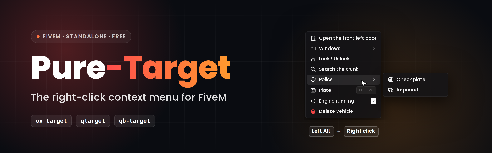
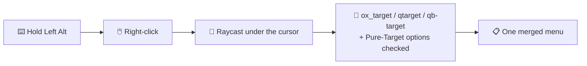

<div align="center">

[](README.md) [](README.fr.md)



<br>

**A standalone right-click context menu for FiveM — drop-in replacement for `ox_target`, `qtarget` and `qb-target`.**<br>
Hold <kbd>Left Alt</kbd>, right-click anything in the world, and act on it.

<br>

[](https://fivem.net)
[](https://www.lua.org)
[](#%EF%B8%8F-configuration)
[](LICENSE)
[](https://github.com/stefanlesuisse/pure-target/releases)
[](https://www.youtube.com/@ma3iich)
[](https://discord.gg/73w9ZanWyv)

**[⬇️ Download](https://github.com/stefanlesuisse/pure-target/releases/latest)** &nbsp;·&nbsp;
**[📦 Installation](#-installation)** &nbsp;·&nbsp;
**[⚙️ Configuration](#%EF%B8%8F-configuration)** &nbsp;·&nbsp;
**[📚 Exports](exports.md)** &nbsp;·&nbsp;
**[💬 Support](https://discord.gg/73w9ZanWyv)**

<sub>Fork of <a href="https://www.youtube.com/watch?v=peS7m275vEY">Off-Target</a> by OffSey · Made by <a href="https://github.com/stefanlesuisse">stefanlesuisse</a></sub>

</div>

---

## 🎬 Preview

<table>
  <tr>
    <th width="33%">🧍 On yourself</th>
    <th width="33%">🚗 On a vehicle</th>
    <th width="33%">👥 On another player</th>
  </tr>
  <tr>
    <td><video src="https://github.com/user-attachments/assets/febb8a09-3055-4492-b8f2-6df00d5b6ddb" width="100%" controls muted></video></td>
    <td><video src="https://github.com/user-attachments/assets/3a4e1e92-412c-4db3-99e9-873c5bdfd65a" width="100%" controls muted></video></td>
    <td><video src="https://github.com/user-attachments/assets/72a18f0b-32a2-4ec7-91aa-7314a5673ad0" width="100%" controls muted></video></td>
  </tr>
</table>

> [!NOTE]
> The options shown in these clips come from our own server's scripts, built with Pure-Target's API.
> On your server, the menu shows the options of **your** scripts.

---

## ✨ Features

<table>
  <tr>
    <td width="50%">🖱️ <b>Right-click menu</b><br><sub>Instead of the classic "eye": hold the key, a cursor appears, right-click what you want.</sub></td>
    <td width="50%">🔌 <b>Drop-in replacement</b><br><sub>For <code>ox_target</code>, <code>qtarget</code> and <code>qb-target</code>: your existing scripts keep working, nothing to edit.</sub></td>
  </tr>
  <tr>
    <td>🧩 <b>Standalone</b><br><sub>No framework, no ox_lib, no database. QBox / QBCore / ESX are detected automatically for job and item filters.</sub></td>
    <td>🎯 <b>Precise targeting</b><br><sub>Picks the exact prop under the cursor, even map props without their own collision (wall ATMs, built-in furniture...).</sub></td>
  </tr>
  <tr>
    <td>📌 <b>Menu stays open</b><br><sub>While the key is held: open several doors in a row, labels update live.</sub></td>
    <td>🚗 <b>Built-in vehicle options</b><br><sub>Open / close the door, hood or trunk you click on, roll windows from inside (synced by the server).</sub></td>
  </tr>
  <tr>
    <td>🎨 <b>Clean UI</b><br><sub>Dark thin-line theme, never off screen, long lists in columns, submenus, checkboxes, tooltips.</sub></td>
    <td>🌍 <b>13 languages</b><br><sub>EN, FR, DE, ES, IT, PT, NL, PL, TR, RU, ZH, JA, KO — easy to add more.</sub></td>
  </tr>
  <tr>
    <td>⚡ <b>Light</b><br><sub>No loop runs while the menu is closed; targeting is computed on right-click only.</sub></td>
    <td>🛠️ <b>Its own API</b><br><sub>Build your own menus: items, checkboxes, submenus, separators, info rows.</sub></td>
  </tr>
</table>

## 🧭 How it works



---

## 📦 Installation

1. **[Download `pure-target.zip`](https://github.com/stefanlesuisse/pure-target/releases/latest)** and extract it into your `resources`.
2. The folder **must be named `pure-target`**.
3. In `server.cfg`, start it **before** the scripts that use a target system:

```cfg
ensure pure-target
```

> [!WARNING]
> **Remove or stop** `ox_target`, `qtarget` and `qb-target`: Pure-Target replaces them
> (it declares `provide 'ox_target'`, `provide 'qtarget'` and `provide 'qb-target'`).

> [!TIP]
> The UI is already built (`web/build`): nothing to compile.

**Requirements:** a recent FiveM server artifact (Lua 5.4, `cerulean`), OneSync recommended for the window sync.
Optional: `ox_inventory`, `qbx_core`, `qb-core` or `es_extended` for the `items` / `groups` filters.

---

## ⚙️ Configuration

Everything is in [`shared/config.lua`](shared/config.lua):

| Key | Default | Description |
| --- | --- | --- |
| `MenuKey` | `'LMENU'` | Key held to show the cursor. Players can rebind it in *Settings → Key Bindings → FiveM*. |
| `Locale` | `'en'` | Language of the built-in options: `en`, `fr`, `de`, `es`, `it`, `pt`, `nl`, `pl`, `tr`, `ru`, `zh`, `ja`, `ko` (add yours in `shared/locales.lua`). |
| `RaycastDistance` | `300.0` | Max raycast distance. |
| `DefaultDistance` | `7.0` | Distance of options without a `distance` field (ox_target default). |
| `MarkerClickRadius` | `18` | Click radius (pixels) of zone markers. |
| `MarkerDrawDistance` | `7.0` | Max distance zone markers are drawn at. |
| `Framework` | `'auto'` | `'auto'`, `'qbx'`, `'qb'`, `'esx'` or `'none'`. |
| `HasGroup` / `GetItemCount` | `nil` | Your own functions for other frameworks. |
| `CanOpen` | function | Return `false` to block the menu (dead, handcuffed...). |
| `IgnoreVehicleModels` | `{}` | Vehicle models handled as plain objects (e.g. wheelchairs). |
| `VehicleDoors` | `true` | Built-in door / hood / trunk options. |
| `VehicleWindows` | `true` | Built-in window options. |

<details>
<summary><b>Example: block the menu while dead</b></summary>

```lua
Config.CanOpen = function()
    return not IsPauseMenuActive() and not IsEntityDead(PlayerPedId())
end
```

</details>

---

## 🛠️ Usage

### With ox_target (unchanged code)

```lua
exports.ox_target:addModel('prop_atm_01', {
    {
        name = 'atm:use',
        label = 'Use ATM',
        icon = 'fa-solid fa-credit-card',
        distance = 2.0,
        onSelect = function(data)
            print('ATM clicked', data.entity)
        end,
    },
})
```

### With the Pure-Target API

```lua
local ContextMenu = exports['pure-target']

ContextMenu:Register(function(entity, entityType, worldPos, hit)
    if not hit or entity ~= PlayerPedId() then return end

    local id = ContextMenu:AddItem(0, 'Hands up', 'fa-solid fa-hand')
    ContextMenu:OnActivate(id, function()
        TaskStartScenarioInPlace(PlayerPedId(), 'WORLD_HUMAN_HANDS_UP', 0, true)
    end)
end)
```

> [!TIP]
> More in [`examples/`](examples/) (a ready-to-start example resource) and every export in [`exports.md`](exports.md).

### Pure-Target extensions to ox_target options

| Field | Effect |
| --- | --- |
| `group = 'Police'` | Options sharing a group are put in a submenu (`groupIcon`, `groupColor`). |
| `description = '...'` | Tooltip. |
| `closeOnClick = true` | Close the menu after this option (default: stays open while the key is held). |
| `addGlobalSelfPlayer` / `addGlobalOtherPlayer` | Options on yourself / on other players. |

---

## ⚖️ Differences with ox_target

- No "eye" and no hover detection: options are computed **once per right-click**, which is why the resource
  costs nothing while the menu is closed.
- The menu stays open while the key is held (see `closeOnClick`).
- Nested menus (`openMenu` / `menuName`) are shown as submenus.
- Supported option fields: see [`exports.md`](exports.md#option-schema).

## 🔒 Security

> [!IMPORTANT]
> `groups`, `items`, `distance` and `canInteract` only decide what is **shown**. Any server event can be
> triggered by a cheater with any arguments: your server scripts must always check job, items, distance, etc.
> themselves. The built-in window option is checked server-side (player seated in that vehicle, right seat,
> rate limit).

---

<details>
<summary><b>🎨 Building the UI (only if you change it)</b></summary>

```bash
cd web
npm ci
npm run build
```

| Command | Description |
| --- | --- |
| `npm run dev` | Browser preview (right-click anywhere to open a demo menu). |
| `npm run build` | Production build into `web/build`. |
| `npm run game` | Rebuild on every change (`vite build --watch`). |

The colours of the menu are at the top of `web/src/features/contextMenu/style.scss`.

</details>

<details>
<summary><b>🗂️ Project structure</b></summary>

```
pure-target/
├─ fxmanifest.lua
├─ shared/
│  ├─ config.lua            # settings
│  └─ locales.lua           # texts of the built-in options
├─ client/
│  ├─ bridge.lua            # framework / inventory detection (groups, items)
│  ├─ core/                 # menu core, key binding, raycast
│  ├─ convert/              # ox_target, qtarget and qb-target layers
│  └─ modules/              # built-in vehicle doors & windows
├─ server/
│  └─ vehicle_windows.lua   # window sync (state bag), server checks
├─ examples/                # example resource
└─ web/                     # React (Vite) UI — build/ is served
```

</details>

---

## 💖 Credits

- **[stefanlesuisse](https://github.com/stefanlesuisse)** — author of Pure-Target.
- **[OffSey](https://www.youtube.com/watch?v=peS7m275vEY)** — original Off-Target, which Pure-Target is a fork of.
- **[Kiminaze — ContextMenu](https://github.com/Kiminaze/ContextMenu)** — the original right-click context
  menu whose ID-based export design this resource follows.
- **[ox_target](https://github.com/overextended/ox_target)** (Overextended) and
  **[qtarget](https://github.com/overextended/qtarget)** — the APIs mirrored by the compatibility layers.
- Icons: [Tabler Icons](https://tabler.io/icons) and [Font Awesome](https://fontawesome.com) (free).

## 📄 License

[MIT](LICENSE) — free to use, modify and share, keep the copyright notice. No warranty.

<div align="center">

<br>

**If Pure-Target helps your server, leave a ⭐ on the repository!**

[](https://www.youtube.com/@ma3iich)
[](https://discord.gg/73w9ZanWyv)
[](https://github.com/stefanlesuisse)

</div>
