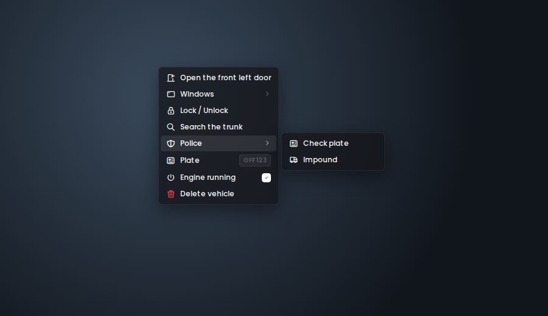

<div align="center">

[](README.md) [](README.fr.md)

# 🎯 Pure-Target

**A standalone right-click context menu for FiveM — drop-in replacement for `ox_target`, `qtarget` and `qb-target`.**

Hold <kbd>Left Alt</kbd>, right-click anything in the world, and act on it.


[](https://github.com/stefanlesuisse/pure-target/releases)

*Fork of [Off-Target](https://www.youtube.com/watch?v=peS7m275vEY) by OffSey.*



</div>

---

## Preview

> The options shown in these clips come from our own server's scripts, built with Pure-Target's API.
> On your server, the menu shows the options of your own scripts.

### On yourself

https://github.com/user-attachments/assets/e0ece559-51f3-4127-bd8c-4b6fcd316272

### On a vehicle

https://github.com/user-attachments/assets/2f420804-ee8d-43c6-9f0b-4ba30d6e3195

### On another player

https://github.com/user-attachments/assets/cd7b0413-4c3d-415d-89a3-28ff4a7c494b

---

## Features

- **Right-click menu** instead of the classic "eye": hold the key, a cursor appears, right-click what you want.
- **Drop-in replacement** for `ox_target`, `qtarget` and `qb-target`: your existing scripts keep working, nothing to edit.
- **Standalone**: no framework, no ox_lib, no database required. QBox / QBCore / ESX are detected automatically
  for job and item filters.
- **Precise targeting**: picks the exact prop under the cursor, even map props without their own collision
  (wall ATMs, built-in furniture...).
- **Menu stays open** while the key is held: open several doors in a row, labels update live.
- **Built-in vehicle options** (can be disabled): open / close the door, hood or trunk you click on, roll
  windows up / down from inside (synced to every player by the server, anti-spam, seat checked).
- **Clean UI**: dark thin-line theme, never goes off screen, long lists split into columns, submenus,
  checkboxes, info rows, tooltips.
- **13 languages** for the built-in options (EN, FR, DE, ES, IT, PT, NL, PL, TR, RU, ZH, JA, KO), easy to add more.
- **Light**: no loop runs while the menu is closed; targeting is computed on right-click only.
- **Its own API** for custom menus (items, checkboxes, submenus, separators, info rows).

## How it works

1. Hold the **menu key** (default <kbd>Left Alt</kbd>): the cursor appears.
2. **Right-click** in the world.
3. A raycast from the cursor finds the entity / model / position under it.
4. Every registered option (ox_target, qtarget, qb-target and the Pure-Target API) is checked.
5. The matching options are merged into one menu.

---

## Installation

1. Download the [latest release](../../releases) (or clone this repository).
2. Put the folder in your `resources` and **name it `pure-target`**.
3. In `server.cfg`, start it **before** the scripts that use a target system:

```cfg
ensure pure-target
```

4. **Remove or stop** `ox_target`, `qtarget` and `qb-target`: pure-target replaces them
   (it declares `provide 'ox_target'`, `provide 'qtarget'` and `provide 'qb-target'`).

The UI is already built (`web/build`): nothing to compile.

### Requirements

- A recent FiveM server artifact (Lua 5.4, `cerulean`). OneSync is recommended for the window sync.
- Nothing else. Optional: `ox_inventory`, `qbx_core`, `qb-core` or `es_extended` for `items` / `groups` filters.

---

## Configuration

Everything is in [`shared/config.lua`](shared/config.lua):

| Key | Default | Description |
| --- | --- | --- |
| `MenuKey` | `'LMENU'` | Key held to show the cursor. Players can rebind it in *Settings → Key Bindings → FiveM*. |
| `Locale` | `'en'` | Language of the built-in options: `en`, `fr`, `de`, `es`, `it`, `pt`, `nl`, `pl`, `tr`, `ru`, `zh`, `ja`, `ko` (add yours in `shared/locales.lua`). |
| `RaycastDistance` | `300.0` | Max raycast distance. |
| `DefaultDistance` | `7.0` | Distance of options without a `distance` field (ox_target default). |
| `MarkerClickRadius` | `18` | Click radius (pixels) of zone markers. |
| `MarkerDrawDistance` | `7.0` | Max distance zone markers are drawn at. |
| `Framework` | `'auto'` | `'auto'`, `'qbx'`, `'qb'`, `'esx'` or `'none'`. |
| `HasGroup` / `GetItemCount` | `nil` | Your own functions for other frameworks. |
| `CanOpen` | function | Return `false` to block the menu (dead, handcuffed...). |
| `IgnoreVehicleModels` | `{}` | Vehicle models handled as plain objects (e.g. wheelchairs). |
| `VehicleDoors` | `true` | Built-in door / hood / trunk options. |
| `VehicleWindows` | `true` | Built-in window options. |

Example, blocking the menu while dead:

```lua
Config.CanOpen = function()
    return not IsPauseMenuActive() and not IsEntityDead(PlayerPedId())
end
```

---

## Usage

### With ox_target (unchanged code)

```lua
exports.ox_target:addModel('prop_atm_01', {
    {
        name = 'atm:use',
        label = 'Use ATM',
        icon = 'fa-solid fa-credit-card',
        distance = 2.0,
        onSelect = function(data)
            print('ATM clicked', data.entity)
        end,
    },
})
```

### With the Pure-Target API

```lua
local ContextMenu = exports['pure-target']

ContextMenu:Register(function(entity, entityType, worldPos, hit)
    if not hit or entity ~= PlayerPedId() then return end

    local id = ContextMenu:AddItem(0, 'Hands up', 'fa-solid fa-hand')
    ContextMenu:OnActivate(id, function()
        TaskStartScenarioInPlace(PlayerPedId(), 'WORLD_HUMAN_HANDS_UP', 0, true)
    end)
end)
```

More in [`examples/`](examples/) (a ready-to-start example resource) and every export in
[`exports.md`](exports.md).

### Pure-Target extensions to ox_target options

- `group = 'Police'`: options sharing a group are put in a submenu (`groupIcon`, `groupColor`).
- `description = '...'`: tooltip.
- `closeOnClick = true`: close the menu after this option (default: stays open while the key is held).
- `addGlobalSelfPlayer` / `addGlobalOtherPlayer`: options on yourself / on other players.

---

## Differences with ox_target

- No "eye" and no hover detection: options are computed **once per right-click**, which is why the resource
  costs nothing while the menu is closed.
- The menu stays open while the key is held (see `closeOnClick`).
- Nested menus (`openMenu` / `menuName`) are shown as submenus.
- Supported option fields: see [`exports.md`](exports.md#option-schema).

## Security

`groups`, `items`, `distance` and `canInteract` only decide what is **shown**. Any server event can be
triggered by a cheater with any arguments: your server scripts must always check job, items, distance, etc.
themselves. The built-in window option is checked server-side (player seated in that vehicle, right seat,
rate limit).

---

## Building the UI (only if you change it)

```bash
cd web
npm ci
npm run build
```

| Command | Description |
| --- | --- |
| `npm run dev` | Browser preview (right-click anywhere to open a demo menu). |
| `npm run build` | Production build into `web/build`. |
| `npm run game` | Rebuild on every change (`vite build --watch`). |

---

## Project structure

```
pure-target/
├─ fxmanifest.lua
├─ shared/
│  ├─ config.lua            # settings
│  └─ locales.lua           # texts of the built-in options
├─ client/
│  ├─ bridge.lua            # framework / inventory detection (groups, items)
│  ├─ core/                 # menu core, key binding, raycast
│  ├─ convert/              # ox_target, qtarget and qb-target layers
│  └─ modules/              # built-in vehicle doors & windows
├─ server/
│  └─ vehicle_windows.lua   # window sync (state bag), server checks
├─ examples/                # example resource
└─ web/                     # React (Vite) UI — build/ is served
```

---

## Credits

- **[OffSey](https://www.youtube.com/watch?v=peS7m275vEY)** — original Off-Target, which Pure-Target is a fork of.
- **[Kiminaze — ContextMenu](https://github.com/Kiminaze/ContextMenu)** — the original right-click context
  menu whose ID-based export design this resource follows.
- **[ox_target](https://github.com/overextended/ox_target)** (Overextended) and
  **[qtarget](https://github.com/overextended/qtarget)** — the APIs mirrored by the compatibility layers.
- Icons: [Tabler Icons](https://tabler.io/icons) and [Font Awesome](https://fontawesome.com) (free).

## License

[MIT](LICENSE) — free to use, modify and share, keep the copyright notice. No warranty.
